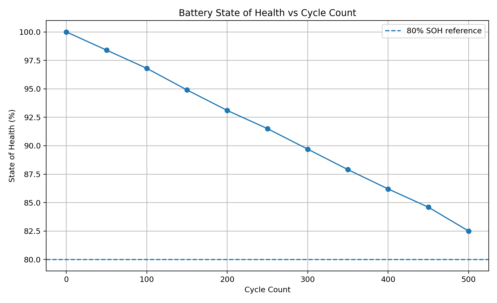

# Battery SOH Analysis

This project explores battery state of health and degradation trends using public or simulated battery cycling data.

The analysis focuses on how battery capacity changes over time and how cycling, temperature, and operating conditions can affect long term battery performance and reliability.

## Project Focus

Battery State of Health

Capacity Degradation

Cycle Life Analysis

Battery Performance Trends

Reliability and Validation

Engineering Data Visualization

## Tools

Python

Pandas

NumPy

Matplotlib

## Project Goals

Analyze battery capacity over repeated charge and discharge cycles.

Track SOH and degradation trends over time.

Identify abnormal changes in battery performance.

Visualize engineering data in a clear and practical way.

Build a simple workflow that can later be expanded for battery validation and reliability analysis.

## SOH Visualization

## Data

This project uses public or simulated battery data only.

No proprietary or confidential vehicle, battery, manufacturing, or company data is used.
